# Cypress Playwright BDD E2E

Testes E2E de front-end escritos em **BDD (Cucumber/Gherkin)**. Os **mesmos arquivos `.feature`** são executados em duas ferramentas: **Cypress** e **Playwright**, em JavaScript (Node.js).


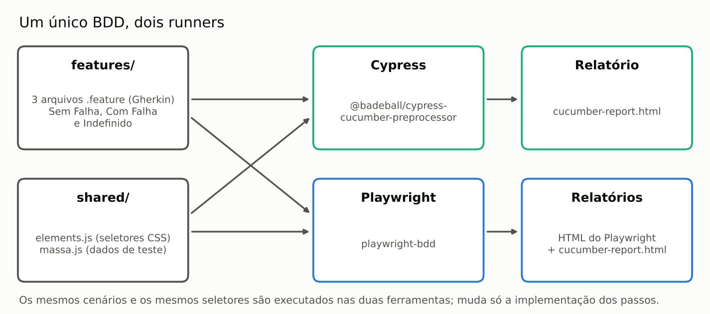

## Sumário

1. [Aplicação testada](#-aplicação-testada)
2. [Cenários BDD](#-cenários-bdd)
3. [Evidências de execução](#-evidências-de-execução)
4. [Como começar](#-como-começar)
5. [Como executar](#-como-executar)
6. [Relatórios](#-relatórios)
7. [Estrutura do projeto](#-estrutura-do-projeto)
8. [Decisões técnicas](#-decisões-técnicas)
9. [CI](#-ci)
10. [Perguntas frequentes em entrevista técnica](#-perguntas-frequentes-em-entrevista-técnica)

---

## 🎯 Aplicação testada

[Tricentis Sample App — Vehicle Insurance](https://sampleapp.tricentis.com/101/app.php): um wizard de cotação de seguro de veículo, com 5 abas em sequência:

1. **Enter Vehicle Data** — dados do veículo (12 campos obrigatórios)
2. **Enter Insurant Data** — dados do segurado (7 campos obrigatórios)
3. **Enter Product Data** — dados do produto (6 campos obrigatórios)
4. **Select Price Option** — escolha do plano (1 campo obrigatório)
5. **Send Quote** — envio da cotação (4 campos obrigatórios)

Cada aba mostra um **contador de campos obrigatórios pendentes**. Os testes validam esse contador antes e depois do preenchimento: ele precisa chegar a **0**.

---

## 🥒 Cenários BDD

Três features, com os mesmos 5 cenários (um por aba do wizard):

| Feature | Objetivo | Resultado esperado |
|---|---|---|
| `01_WizardDadosVeiculo_SemFalha.feature` | Fluxo completo, do veículo ao envio da cotação | ✅ Todos os cenários passam |
| `02_WizardDadosVeiculo_ComFalha.feature` | Demonstrar um teste **com falha**: o último cenário espera 14 campos, mas a aba tem 4 | ❌ Falha intencional no último cenário |
| `03_WizardDadosVeiculo_Indefinido.feature` | Demonstrar um passo **indefinido** (sem implementação) | ⚠️ Último cenário falha com "passo não implementado" |

Exemplo (`01_WizardDadosVeiculo_SemFalha.feature`):

```gherkin
Feature: 01 - Wizard Dados do Veiculo - SEM FALHA

Scenario: Inserir Dados do Veiculo
    Given acessar o frame Enter Vehicle Data igual a doze campos
    When permitir preencher ou selecionar os dados dos campos do veículo
    And clicar o frame Enter Vehicle Data igual a zero campos
    Then clicar no botao Next para o sistema redirecionar para o frame Enter Insurant Data
```

---

## 📸 Evidências de execução

Execuções reais no Cypress, contra a aplicação Tricentis Sample App.

### BDD e implementação dos passos

**Feature `01_WizardDadosVeiculo_SemFalha.feature` (Gherkin):**

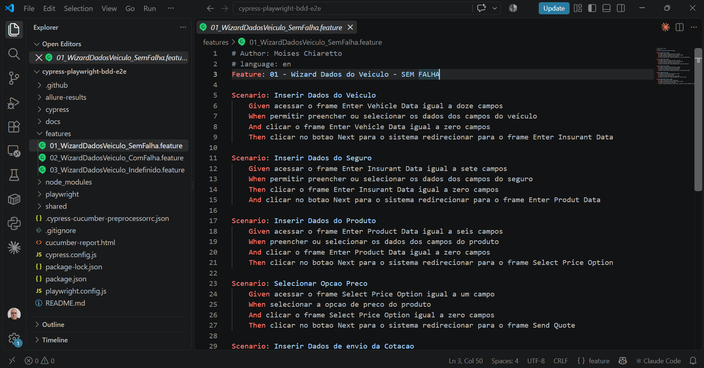

**Implementação dos passos no Cypress (`C001_EnterVehicleData.steps.js`):**

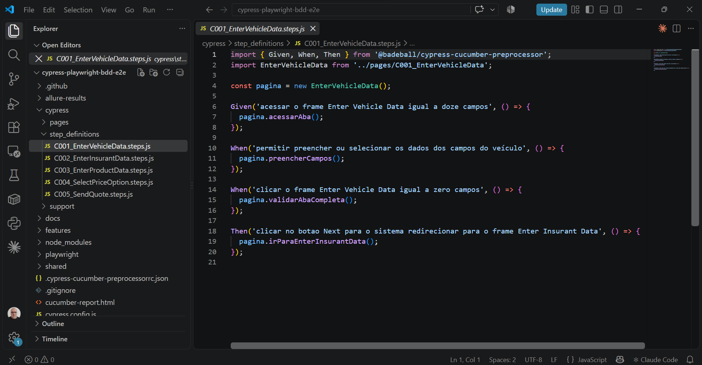

### 01 — SEM FALHA ✅

Resultado: **5 cenários executados, 5 aprovados.**

**Terminal — execução dos cenários:**

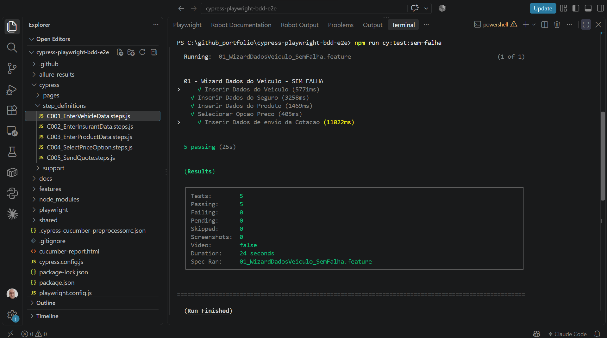

**Terminal — resumo da execução:**

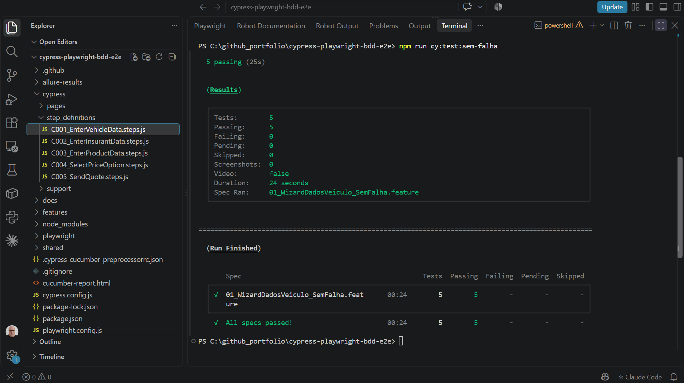

**Allure Report — visão geral (100% aprovado):**

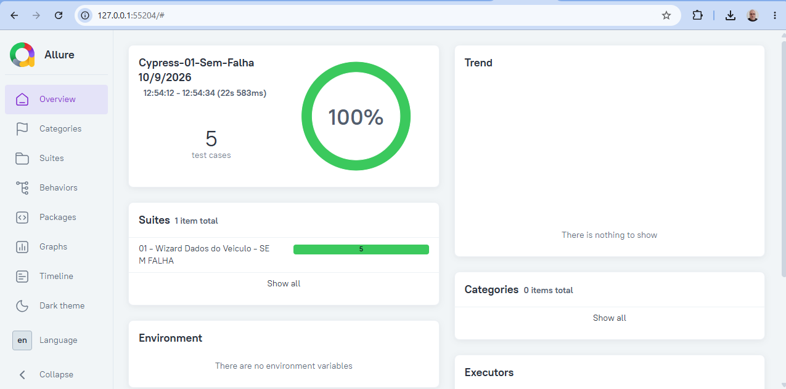

**Allure Report — passos do cenário "Inserir Dados de envio da Cotacao":**

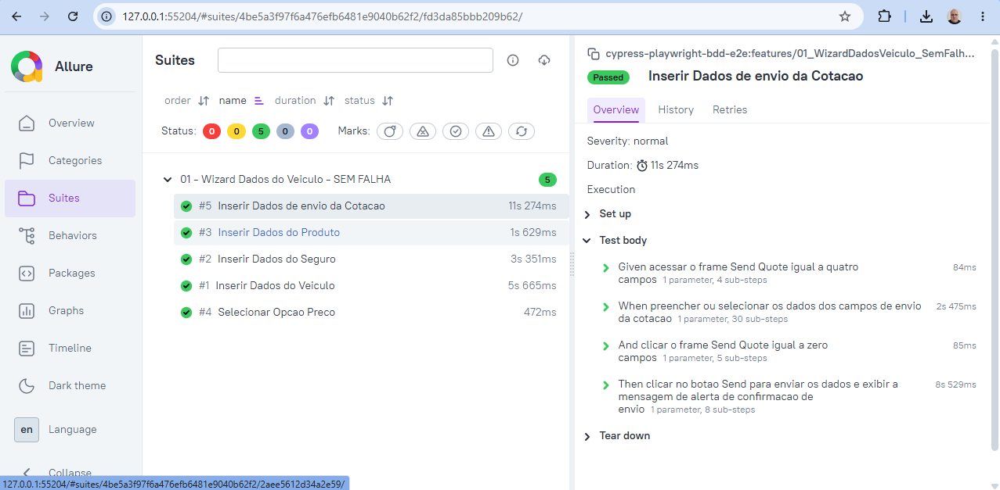

### 02 — COM FALHA ❌

Resultado: **5 cenários executados, 4 aprovados e 1 com falha.** A falha é intencional: o último cenário espera 14 campos obrigatórios na aba Send Quote, que tem 4. O Allure classifica como **Product defects** (falha de verificação).

**Terminal — resumo da execução:**

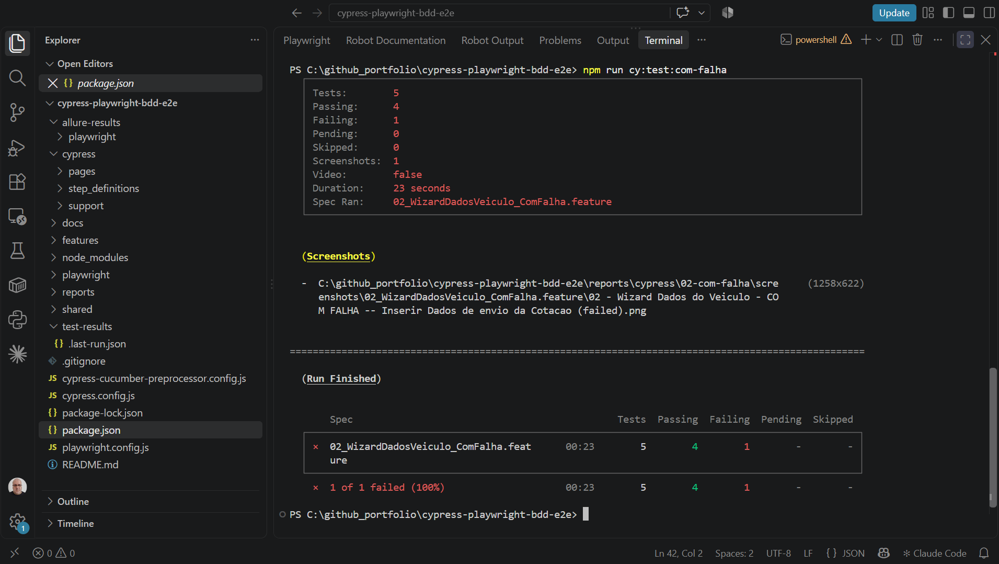

**Allure Report — visão geral (80% aprovado):**

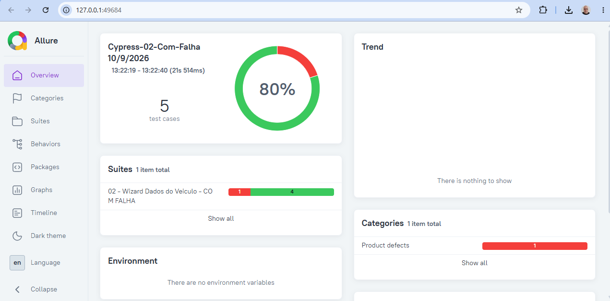

**Allure Report — detalhe da falha:** `expected '<span.counter>' to have text '14', but the text was '4'`

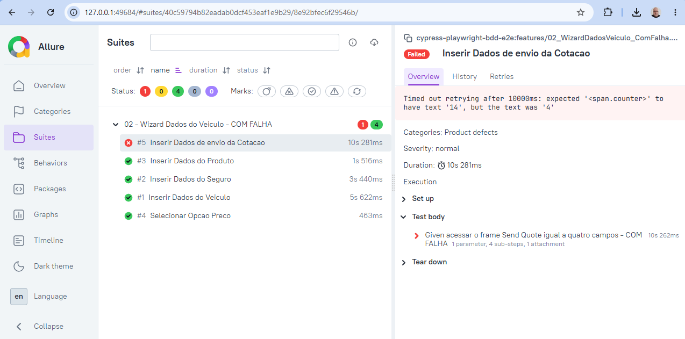

### 03 — INDEFINIDO ⚠️

Resultado: **5 cenários executados, 4 aprovados e 1 quebrado (broken).** O passo `acessar o frame Send Quote igual a quatro campos_XXXXXXXXXX` não tem implementação. O Allure classifica como **Test defects** (problema no próprio teste, e não na aplicação).

**Terminal — resumo da execução:**

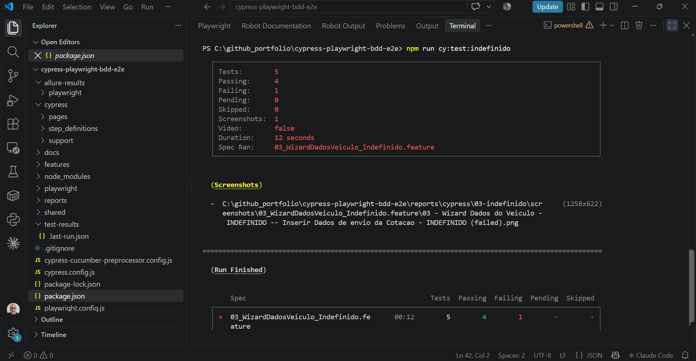

**Allure Report — visão geral:**

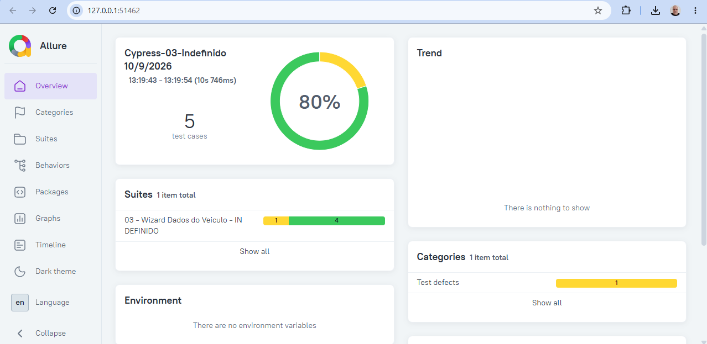

**Allure Report — detalhe:** `Step implementation missing`, com a sugestão de implementação gerada pelo próprio plugin de BDD.

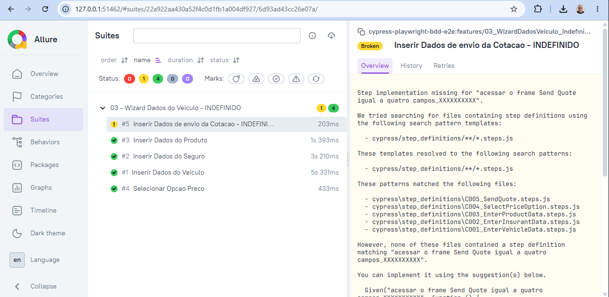

### Falha x passo indefinido no Allure

| Situação | Status no Allure | Categoria | Significado |
|---|---|---|---|
| COM FALHA | **Failed** (vermelho) | Product defects | O passo existe, mas o resultado da tela não bateu com o esperado |
| INDEFINIDO | **Broken** (amarelo) | Test defects | O passo escrito no `.feature` não tem implementação |

---

## 🚀 Como começar

Pré-requisitos: **Node.js 20 ou superior**, **Google Chrome** e **Java 8 ou superior** (para o relatório Allure).

```bash
# 1. Clone o repositório
git clone https://github.com/moiseschiaretto/cypress-playwright-bdd-e2e.git
cd cypress-playwright-bdd-e2e

# 2. Instale as dependências (inclui o Cypress)
npm install

# 3. Instale o navegador do Playwright
npx playwright install chromium
```

---

## ▶️ Como executar

### Cypress

```bash
npm run cy:test:sem-falha     # feature 01 — SEM FALHA
npm run cy:test:com-falha     # feature 02 — COM FALHA
npm run cy:test:indefinido    # feature 03 — INDEFINIDO
npm run cy:test               # as 3 features
npm run cy:open               # modo interativo
```

### Playwright

```bash
npm run pw:test:sem-falha     # feature 01 — SEM FALHA
npm run pw:test:com-falha     # feature 02 — COM FALHA
npm run pw:test:indefinido    # feature 03 — INDEFINIDO
npm run pw:test               # as 3 features
npm run pw:report             # abre o relatório HTML do Playwright
```

O comando `bddgen`, executado antes do `playwright test`, gera os arquivos de teste do Playwright a partir dos `.feature` (pasta `.features-gen/`, não versionada).

### As duas ferramentas

```bash
npm run test:sem-falha        # feature 01 no Cypress e no Playwright
```

---

## 📊 Relatórios

Cada feature gera **os próprios relatórios**, em pastas separadas. São dois tipos:

- **relatório padrão**: o relatório Cucumber em HTML (as duas ferramentas) e o relatório HTML do Playwright;
- **relatório Allure**: um por feature e por ferramenta, ou seja, **6 relatórios Allure** (3 do Cypress e 3 do Playwright).

### Relatório padrão

| Ferramenta | Relatório | Local |
|---|---|---|
| Cypress | Cucumber HTML | `reports/cypress/<feature>/cucumber-report.html` |
| Cypress | Screenshots de falha | `reports/cypress/<feature>/screenshots/` |
| Playwright | HTML do Playwright (com trace e screenshot de falha) | `reports/playwright/<feature>/html/index.html` |
| Playwright | Cucumber HTML | `reports/playwright/<feature>/cucumber-report.html` |

`<feature>` é `01-sem-falha`, `02-com-falha` ou `03-indefinido`.

Para abrir o relatório HTML do Playwright:

```bash
npm run pw:report:sem-falha
npm run pw:report:com-falha
npm run pw:report:indefinido
```

### Relatório Allure

Primeiro execute a feature; depois gere e abra o relatório Allure correspondente:

| Feature | Cypress | Playwright |
|---|---|---|
| 01 — SEM FALHA | `npm run allure:cy:sem-falha` | `npm run allure:pw:sem-falha` |
| 02 — COM FALHA | `npm run allure:cy:com-falha` | `npm run allure:pw:com-falha` |
| 03 — INDEFINIDO | `npm run allure:cy:indefinido` | `npm run allure:pw:indefinido` |

Exemplo completo:

```bash
npm run pw:test:com-falha
npm run allure:pw:com-falha
```

| Pasta | Conteúdo |
|---|---|
| `allure-results/<ferramenta>/<feature>/` | Resultados brutos da execução (apagados a cada nova execução da mesma feature) |
| `allure-report/<ferramenta>/<feature>/` | Relatório Allure gerado |

O relatório Allure é gerado pelo `allure-commandline` (Allure Report 2, o relatório clássico), instalado junto com o projeto. **Requisito: Java 8 ou superior** (`java -version`). O relatório é gerado em arquivo único (`index.html`), que também pode ser aberto direto no Chrome.

---

## 📁 Estrutura do projeto

```
features/                          # BDD único (Gherkin), usado pelos dois runners
  01_WizardDadosVeiculo_SemFalha.feature
  02_WizardDadosVeiculo_ComFalha.feature
  03_WizardDadosVeiculo_Indefinido.feature
shared/                            # código comum às duas ferramentas
  elements.js                      # seletores CSS de cada aba
  massa.js                         # dados de teste e quantidade de campos obrigatórios
cypress/
  pages/                           # page objects (Cypress)
  step_definitions/                # implementação dos passos (Cypress)
  support/e2e.js
playwright/
  pages/                           # page objects (Playwright)
  steps/                           # implementação dos passos (Playwright)
  fixtures.js                      # página compartilhada entre os cenários e page objects
cypress.config.js                  # Cypress + BDD + Allure
playwright.config.js               # Playwright + BDD + Allure
cypress-cucumber-preprocessor.config.js   # BDD no Cypress + caminho do relatório padrão
.github/workflows/e2e.yml          # CI: Cypress e Playwright em paralelo
docs/screenshots/                  # imagens da documentação
```

---

## 🧠 Decisões técnicas

| Decisão | Motivo |
|---|---|
| **Um único conjunto de `.feature`** para as duas ferramentas | O BDD descreve o comportamento, não a ferramenta. Os mesmos cenários rodam no Cypress e no Playwright |
| **Seletores e massa de teste em `shared/`** | Uma mudança na tela é corrigida em um só lugar |
| **`@badeball/cypress-cucumber-preprocessor`** | Plugin de BDD mantido para o Cypress (o antigo `cypress-cucumber-preprocessor` foi descontinuado) |
| **`playwright-bdd`** | Converte os `.feature` em testes nativos do Playwright, com relatório, trace e paralelismo |
| **Relatórios separados por feature** | Cada cenário de demonstração (Sem Falha, Com Falha e Indefinido) tem seu próprio relatório padrão e seu próprio relatório Allure |
| **`cypress-on-fix`** | O Cypress aceita só um tratador por evento; o `cypress-on-fix` permite que o plugin de BDD e o Allure funcionem juntos |
| **Seletores CSS por id**, sem XPath absoluto | Não quebram com mudanças de layout |
| **Esperas condicionais**, sem `cy.wait()` fixo | O teste espera o elemento ou a mensagem aparecer, nem mais nem menos |
| **Data de início do seguro calculada** | A aplicação exige uma data pelo menos 1 mês no futuro; uma data fixa no código expiraria |
| **Cenários em sequência** (`testIsolation: false` no Cypress; página compartilhada no Playwright) | Cada cenário corresponde a uma aba do wizard e continua de onde o anterior parou. Se um cenário falha, os seguintes também falham |
| **Radio e checkbox marcados pelo `<label>`** | Os inputs da aplicação ficam escondidos; o clique é feito no label e a verificação (`be.checked` / `toBeChecked`) no input |

---

## 🔄 CI

O workflow `.github/workflows/e2e.yml` roda a cada push e pull request na `main`, com dois jobs em paralelo:

- **cypress**: executa a feature SEM FALHA no Cypress;
- **playwright**: executa a feature SEM FALHA no Playwright.

Os relatórios padrão e o relatório Allure de cada job são publicados como artefatos (`relatorios-cypress` e `relatorios-playwright`), com retenção de 30 dias.

As features COM FALHA e INDEFINIDO ficam fora do CI porque falham de propósito: elas servem para demonstrar como cada ferramenta reporta uma falha e um passo indefinido.

---

## 🎤 Perguntas frequentes em entrevista técnica

**Por que usar o mesmo BDD em duas ferramentas?**
Porque o BDD descreve o comportamento do sistema, independente da ferramenta. Com os mesmos `.feature`, dá para comparar Cypress e Playwright no mesmo cenário ou migrar de uma ferramenta para outra sem reescrever a especificação.

**Qual a diferença entre um passo com falha e um passo indefinido?**
Com falha: o passo tem implementação, mas a verificação não bate com o esperado. Indefinido: o texto do passo no `.feature` não corresponde a nenhuma implementação.

**Por que os cenários dependem um do outro?**
Porque cada cenário representa uma aba de um wizard contínuo. A alternativa seria cada cenário preencher todas as abas anteriores, o que deixaria a execução mais lenta e repetitiva.

**Por que não usar `cy.wait(10000)`?**
Espera fixa deixa o teste lento quando a aplicação é rápida e instável quando é lenta. A espera condicional aguarda exatamente a condição esperada.

**Quais as principais diferenças entre Cypress e Playwright?**
O Cypress roda dentro do navegador e usa uma fila de comandos (`cy.get(...).should(...)`). O Playwright controla o navegador por fora, usa `async/await`, suporta várias abas e vários navegadores e roda testes em paralelo de forma nativa.
